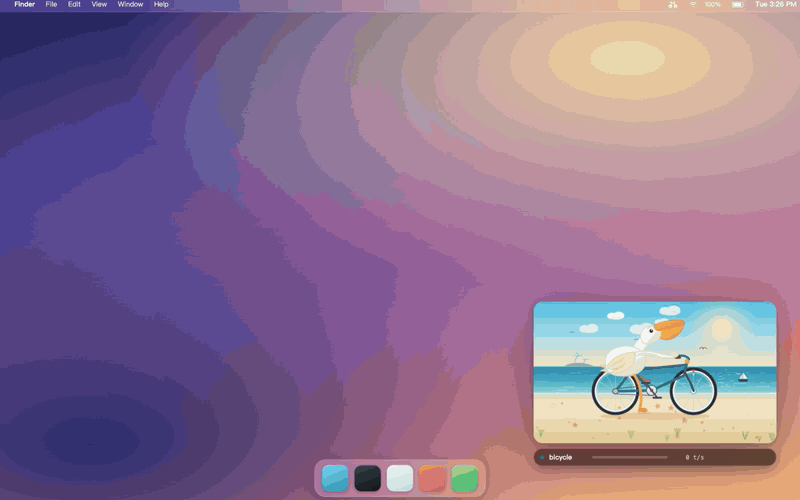

# 海边骑车的鹈鹕

一只鹈鹕在海边骑车，住在你屏幕的角落里。agent 干活的时候它就蹬起来；每秒烧的 token 越多，它蹬得越狠。活儿一停，它就滑行着站住，抬头看海。



[English](README.md) · 中文

## 装上

只支持 macOS，需要 Xcode 命令行工具里的 `swiftc`。一条命令构建好，放进 `~/Applications`：

```bash
./install.sh
```

之后开 `~/Applications/Pelican.app`：双击，或者按 ⌘ 空格搜 Pelican。改了代码就重跑这条命令。

你会得到一个透明小窗，一直浮在别的窗口上面。没有 Dock 图标，唯一的手柄是菜单栏上那辆小自行车。

## 摆弄它

按住窗口任意位置就能拖走。菜单栏那辆自行车用来显示、隐藏、切三档大小、设开机自启、退出。你把它放在哪、放多大，下次打开还是那样。

## 它会换车

蹬得慢是自行车。加快换电动车，再快上摩托车。要是一下来一大波 token，就直接从自行车跳到摩托车，不在半路闪一下电动车。收工的时候按原路一级级换回来。

## 停下来的时候

token 不再进来，它先滑行到停住，把靠近你这侧的那只脚撑在沙子上，另一只留在踏板上，然后抬头看海。要先等一下才撑脚，两次工具调用之间的空档不会让它下车。

## 它看天色

白天是亮青色的海滩。下午四点往后太阳落下来，光变成琥珀色。过了七点就是夜里：星星出来，月亮替掉太阳，车头灯在车前铺一小片光。用的是本机时钟，没有要配的东西。

## 什么在让它蹬

本机在跑的 Hermes、Codex、Claude Code。哪个在烧 token 就由哪个蹬，不分亲疏。

Hermes 在一轮对话进行期间会持续续约；Codex 和 Claude Code 把 token 数写在会话日志里，速度就是从这儿读的。要是某个 harness 写的东西里读不出 token，就退回按日志涨得多快来估。

还想盯别的目录，一行一个路径写进 `app/agents.txt`。这个文件故意不进仓库。

## 不对劲的时候

- 改了 `app/pelican.html` 却没变化：重跑 `./install.sh`。每份 app 画的都是自己包里的那份画面。
- 窗口跑到屏幕外：`defaults delete local.pelican.float origin`
- 想换默认宽度：`defaults write local.pelican.float width -float 480`

## 自检

```bash
./check.sh
```

这项目没有测试框架，所以自检是几条「真的会失败」的检查：页面 JS 能过语法、打包进 app 的那份和源文件逐字节一致、无头渲染一帧证明画面真的画了、曲柄转一圈后轮转两圈、收工时曲柄冻住而轮子还在转、夜里那套光是真的换了、每段滚动背景只画一遍再复制一份，海沙也就在接缝处不跳了、停下时真的有一只脚撑在沙面上，骑起来两只脚都回到踏板、一大波 token 会让它直接上摩托而不会在半路闪一下电动车、车灯是照在车前方而不是身后。

## 开机自启

菜单栏里勾「开机自启」，系统就会在登录时把它起来；再点一下取消。系统「登录项」里能看到这一条，不是什么藏起来的东西。

## 许可证

MIT。拿去用，随便改。
